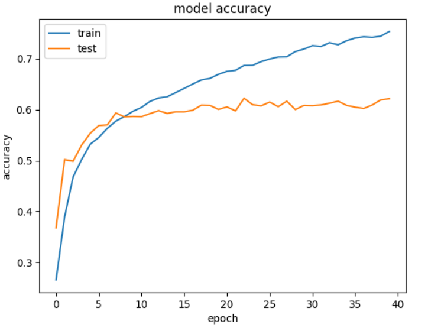
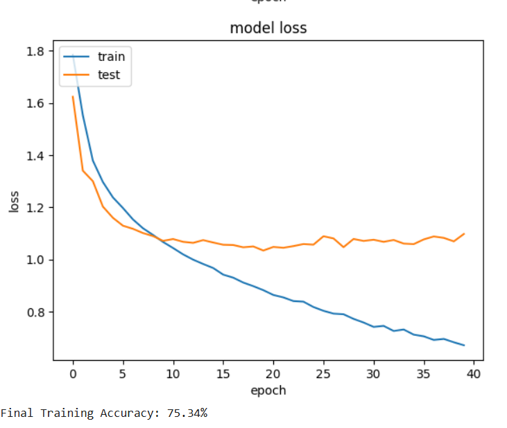
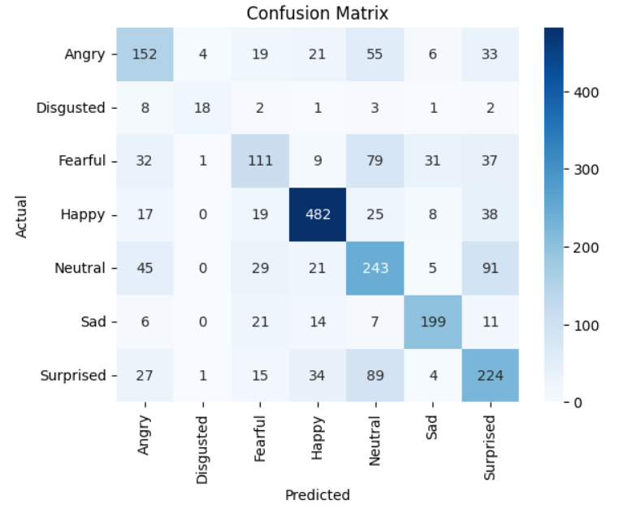
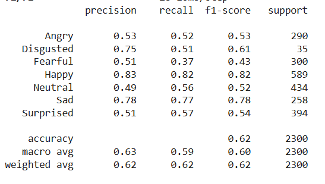

# CNN-Based Facial Emotion Detection

A facial emotion recognition system built using Convolutional Neural Networks (CNN), TensorFlow, Keras and OpenCV. The application detects human faces and classifies facial expressions into seven emotion categories using the FER2013 dataset.

## Project Overview

The system uses a CNN-based deep learning model trained on the FER2013 facial expression dataset to recognise seven emotions:

- Angry
- Disgusted
- Fearful
- Happy
- Neutral
- Sad
- Surprised

OpenCV is used for face detection, while the trained CNN model predicts the emotion associated with detected facial expressions.

## Demo


## Model Training & Evaluation

The CNN model was trained on the FER2013 dataset over 40 epochs.

**Training Accuracy: 75.34%**

**Test Accuracy: Approximately 62%**

### Training Accuracy



### Training Loss



### Confusion Matrix



### Classification Report



The classification report evaluates model performance using precision, recall and F1-score across the seven emotion categories.

## Technology Stack

- **Programming Language:** Python
- **Deep Learning:** TensorFlow, Keras
- **Computer Vision:** OpenCV
- **Numerical Processing:** NumPy
- **Image Processing:** Pillow
- **Dataset:** FER2013

## Installation

### 1. Clone the repository

```bash
git clone https://github.com/akankshauniyal/Emotion_detection_with_CNN.git
cd Emotion_detection_with_CNN
```

### 2. Install dependencies

```bash
pip install -r requirements.txt
```

### 3. Download the FER2013 dataset

Download the dataset from Kaggle:

https://www.kaggle.com/datasets/msambare/fer2013

Place the dataset in the expected `data/` directory if training the model from scratch.

### 4. Train the model

```bash
python TrainEmotionDetector.py
```

Training time depends on the available hardware and dataset configuration.

The training process generates the model architecture and trained weights, which should be saved in the expected model directory.

### 5. Run emotion detection

```bash
python TestEmotionDetector.py
```

### 6. Evaluate the model

```bash
python EvaluateEmotionDetector.py
```

## Project Highlights

- Implemented a CNN-based facial emotion classification model.
- Used OpenCV for face detection.
- Trained and evaluated the model using FER2013.
- Analysed training performance through accuracy and loss curves.
- Evaluated classification performance using a confusion matrix and precision, recall and F1-score.

## Key Learnings

Gained practical experience in deep learning, CNN architecture, computer vision, image preprocessing, model training, performance evaluation and integrating trained models into Python applications.

---

**Developed by Akanksha Uniyal**


### run your emotion detection test file
python TestEmotionDetector.py
